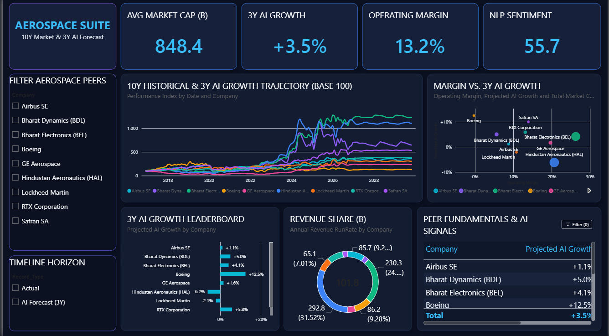
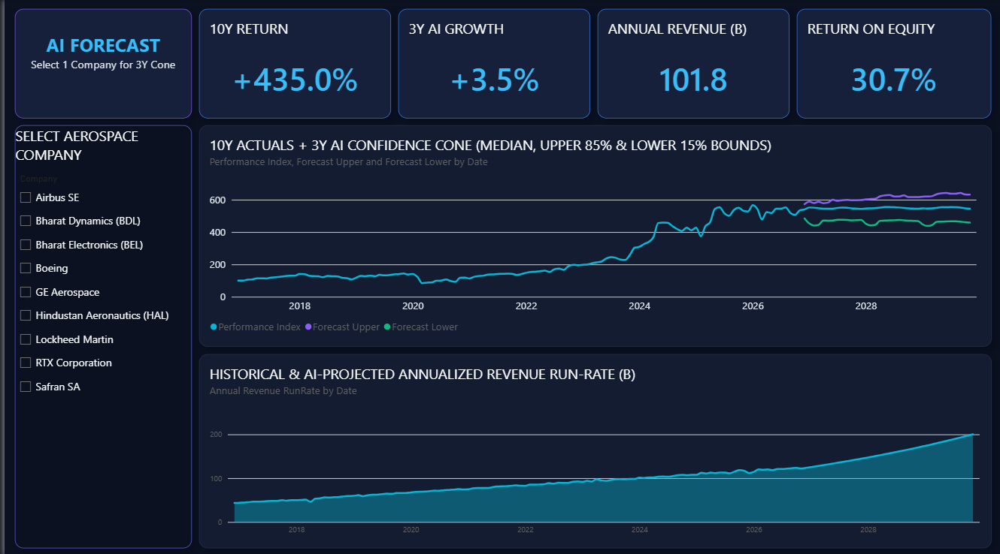
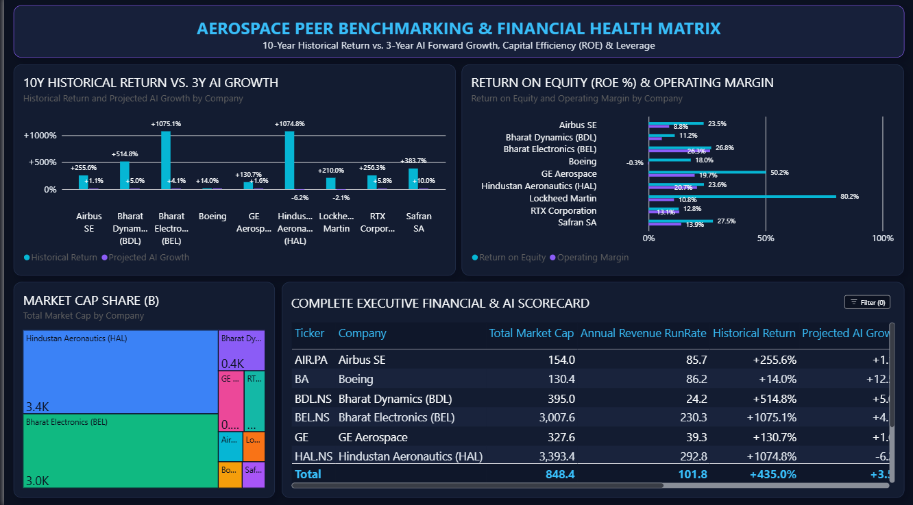
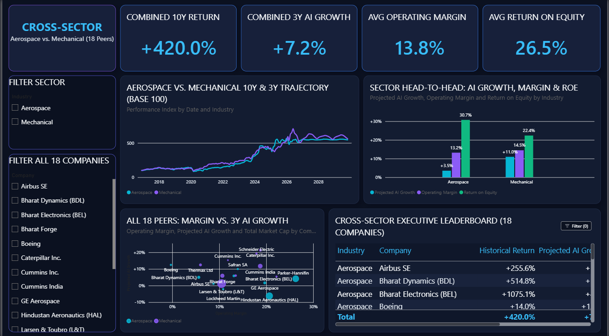

# Aerospace & Mechanical Intelligence Suite


An end-to-end **Power BI Project (PBIP / TMDL)** business intelligence and quantitative forecasting pipeline benchmarking **18 global and Indian aerospace, defense, and industrial engineering leaders** across a **10-year historical horizon (2016?2026)** and a **3-year AI-projected trajectory (2026?2029)**.

Instead of manually clicking together static `.pbix` binaries, the entire semantic model (`TMDL`), DAX measure layer, custom dark-mode theme (`RoyalAuroraCrossSector`), and 4-page `PBIR` visual layout are **generated programmatically in Python** for version-controlled BI engineering.

---

## Dashboard Previews

### 1. Executive Command Center


### 2. Company Deep-Dive & 3-Year AI Confidence Cone


### 3. Peer Valuation & Financial Health Matrix


### 4. Cross-Sector Comparison (Aerospace vs. Mechanical ? 18 Peers)


---

## Key Cross-Sector Insights

| Metric | Aerospace & Defense (9 Peers) | Mechanical & Industrial (9 Peers) | Combined Portfolio (18 Peers) |
| :--- | :---: | :---: | :---: |
| **10-Year Historical Return** | **+435.0%** | +405.1% | +420.0% |
| **3-Year AI Projected Growth** | +3.5% | **+11.0%** | +7.2% |
| **Average Operating Margin** | 13.2% | **14.5%** | 13.8% |
| **Average Return on Equity (ROE)** | **30.8%** | 22.4% | 26.6% |
| **NLP News Sentiment Score** | **55.7** | 52.4 | 54.0 |

---

## Repository Architecture

```text
Aerospace-Mechanical-BI-Suite/
|-- 01_fetch_and_forecast.py         # Market ingestion, Base-100 normalization & 3Y AI confidence bounds
|-- 02_generate_pbip.py              # Programmatic PBIP, TMDL semantic model, DAX & PBIR report generator
|-- requirements.txt                 # Python dependencies
|-- LICENSE                          # MIT License
|-- assets/                          # High-resolution dashboard previews
|-- data/
|   |-- aerospace_data.csv           # 9 Aerospace & Defense peers (1,371 monthly records)
|   +-- mechanical_data.csv          # 9 Mechanical & Industrial peers (1,404 monthly records)
+-- output/
    |-- Aerospace_Intelligence/      # 4-page Power BI Project (.pbip + .Report + .SemanticModel)
    +-- Mechanical_Intelligence/     # 4-page Power BI Project (.pbip + .Report + .SemanticModel)
```

---

## Covered Peer Universe

* **Aerospace & Defense:** Airbus SE (`AIR.PA`), Bharat Dynamics (`BDL.NS`), Bharat Electronics (`BEL.NS`), Boeing (`BA`), GE Aerospace (`GE`), Hindustan Aeronautics (`HAL.NS`), Lockheed Martin (`LMT`), RTX Corporation (`RTX`), Safran SA (`SAF.PA`).
* **Mechanical & Industrial:** Bharat Forge (`BHARATFORG.NS`), Caterpillar (`CAT`), Cummins Inc. (`CMI`), Cummins India (`CUMMINSIND.NS`), Larsen & Toubro (`LT.NS`), Parker-Hannifin (`PH`), Schneider Electric (`SU.PA`), Siemens AG (`SIE.DE`), Thermax (`THERMAX.NS`).

---

## Quickstart

```bash
# 1. Install Python dependencies
pip install -r requirements.txt

# 2. Fetch market data and generate 3-year AI forecast cones
python 01_fetch_and_forecast.py

# 3. Build PBIP, TMDL semantic models, and 4-page PBIR reports
python 02_generate_pbip.py
```

Open `output/Aerospace_Intelligence/Aerospace_Intelligence.pbip` or `output/Mechanical_Intelligence/Mechanical_Intelligence.pbip` in **Power BI Desktop** and click **Refresh** in the **Home** ribbon.
